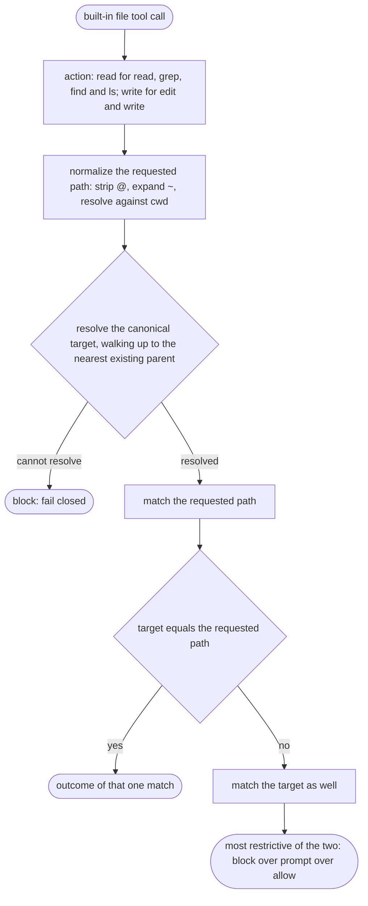
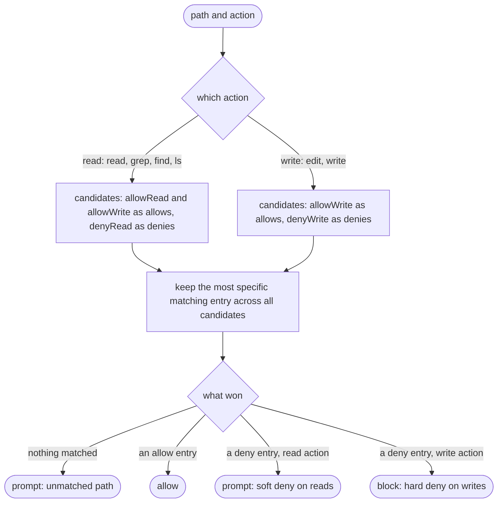
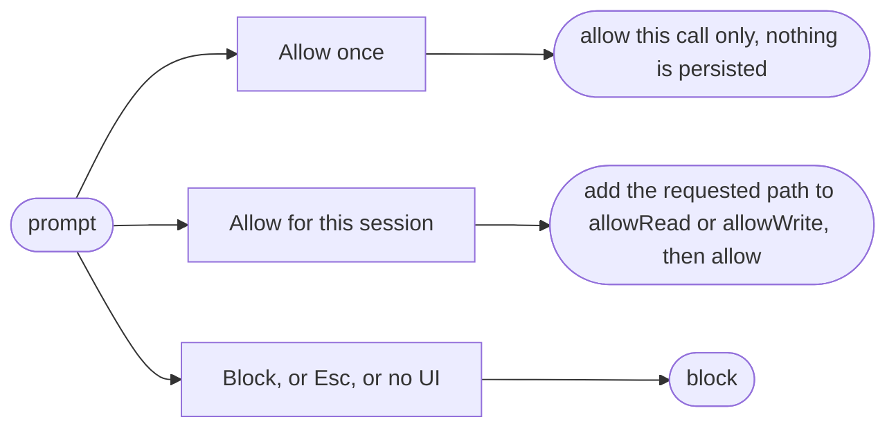

# Permission flow: new-mode path-list policy

How the `denyRead` / `allowRead` / `allowWrite` / `denyWrite` policy decides a built-in file tool call, and what happens for each combination of arrays a path can match. Derived from `src/index.ts` (dispatch) and `src/path-policy.ts` (matching).

## From tool call to action

- `read`, `grep`, `find` and `ls` are **read** calls.
- `edit` and `write` are **write** calls.
- Reads inside the Pi install directory are allowed before the policy runs (reads only, never writes or edits).

## Step 1: the requested path and its resolved target



## Step 2: which arrays are consulted



So for a read a path may match `allowRead`, `allowWrite` or `denyRead`; for a write it may match `allowWrite` or `denyWrite`. `allowWrite` counts as an allow for reads too.

## Step 3: what happens for each combination

| The path matches…                            | Read (`read`, `grep`, `find`, `ls`)        | Write (`edit`, `write`)                |
| -------------------------------------------- | ------------------------------------------ | -------------------------------------- |
| nothing in any array                         | prompt                                     | prompt                                 |
| an allow entry only                          | allow                                      | allow                                  |
| a deny entry only (`denyRead` / `denyWrite`) | prompt: a read deny is a soft deny         | block: a write deny is a hard deny     |
| an allow **and** a deny entry                | most specific wins; a tie goes to the deny | most specific wins; a tie goes to deny |

### Specificity, most to least

1. An exact path to a file.
2. A glob, ranked by how many literal characters it has.
3. A directory prefix, ranked by resolved path length.
4. The region-wide tokens `:external` and `*`.

Entry shape decides the kind: `e2e/` (trailing slash) or an existing directory is a directory prefix and covers the whole subtree; anything with glob metacharacters is a glob; `*` alone means every path; `:external` means anything outside the project. On an exact tie the deny wins.

### Worked examples with the default arrays

```jsonc
"fileAccess": {
  "denyRead":   ["**/.env*"],
  "allowRead":  [".", "./**/.env.development"],
  "allowWrite": [],
  "denyWrite":  ["**/.env*", "**/.git/**", "**/node_modules/**", ":external"]
}
```

| Call                                                                                 | Candidates that match                                                           | Winner                                            | Outcome           |
| ------------------------------------------------------------------------------------ | ------------------------------------------------------------------------------- | ------------------------------------------------- | ----------------- |
| read `src/index.ts`                                                                  | `allowRead`: `.`                                                                | `.` - directory, only match                       | allow             |
| read `.env`                                                                          | `allowRead`: `.`; `denyRead`: `**/.env*`                                        | `**/.env*` - glob outranks a directory            | prompt, soft deny |
| read `./.env.development`                                                            | `allowRead`: `.`, `./**/.env.development`; `denyRead`: `**/.env*`               | `./**/.env.development` - glob with more literals | allow             |
| read `~/.ssh/config`                                                                 | nothing                                                                         | none                                              | prompt            |
| write `e2e/snapshot.spec.ts`                                                         | nothing in `allowWrite` or `denyWrite`                                          | none                                              | prompt            |
| write `.env`                                                                         | `denyWrite`: `**/.env*`                                                         | `**/.env*` - glob deny                            | block, no prompt  |
| write `/etc/hosts`                                                                   | `denyWrite`: `:external`                                                        | `:external` - region token deny                   | block, no prompt  |
| write `src/index.ts`, with `allowWrite: ["."]`                                       | `allowWrite`: `.` - `:external` matches only paths outside the project          | `.` - the only match                              | allow             |
| write `e2e/x.ts`, with `allowWrite: ["e2e/"]` and `e2e` a symlink to an external dir | requested path: `allowWrite`: `e2e/`; resolved target: `denyWrite`: `:external` | the target is denied, and a denied write blocks   | block, no prompt  |

## Step 4: prompt outcomes



- Reads, `grep`, `find` and `ls` add to `allowRead`; `edit` and `write` add to `allowWrite`.
- The entry is the requested path relative to the project, or the absolute path when outside it; the project root becomes `.`. A directory entry covers that directory and everything under it.
- The resolved target is never added, so a prompt raised by a symlinked target (for example `/etc/hosts`, which resolves to `/private/etc/hosts`) can repeat even after granting.
- Session grants live in the running process: `/lockdown:reset` or a new session clears them, they are never written to `settings.json`, and subagent processes never inherit them.
- Every prompt fails closed when there is no UI, so headless and subagent calls that would prompt are blocked instead.

## Outside this flow

- `bash` is blocked outright and never reaches the policy.
- `write` calls with empty content are blocked as a soft-delete guard.
- Custom tools never use the path policy; they use their `customTools` level, edited from the same `/lockdown:session-permissions` menu.
- Legacy configs (the `external` / `internal` matrix) run the old engine and its `warn` prompts. See the package README.
